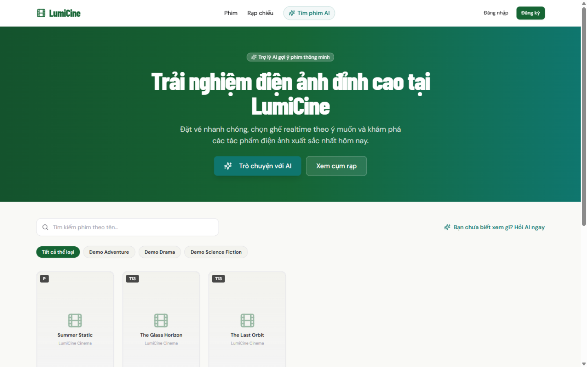
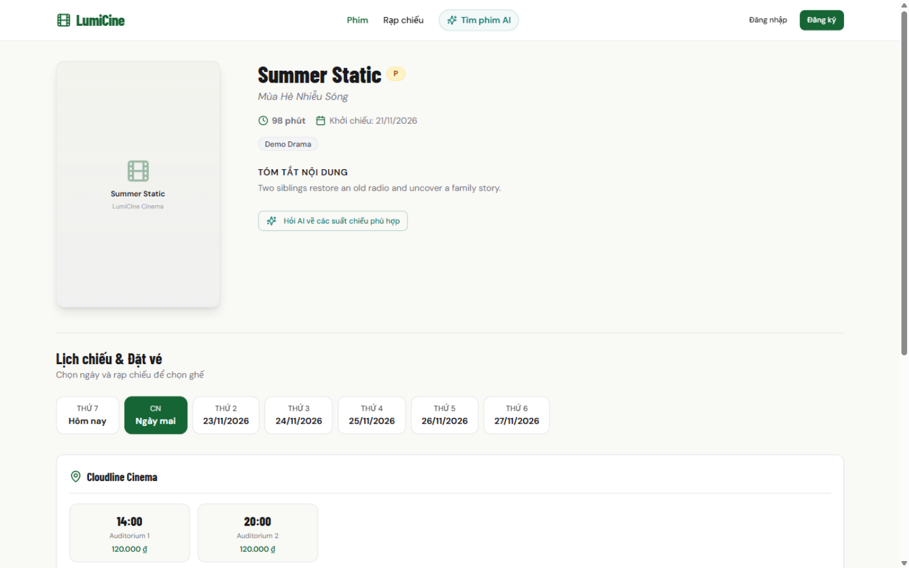
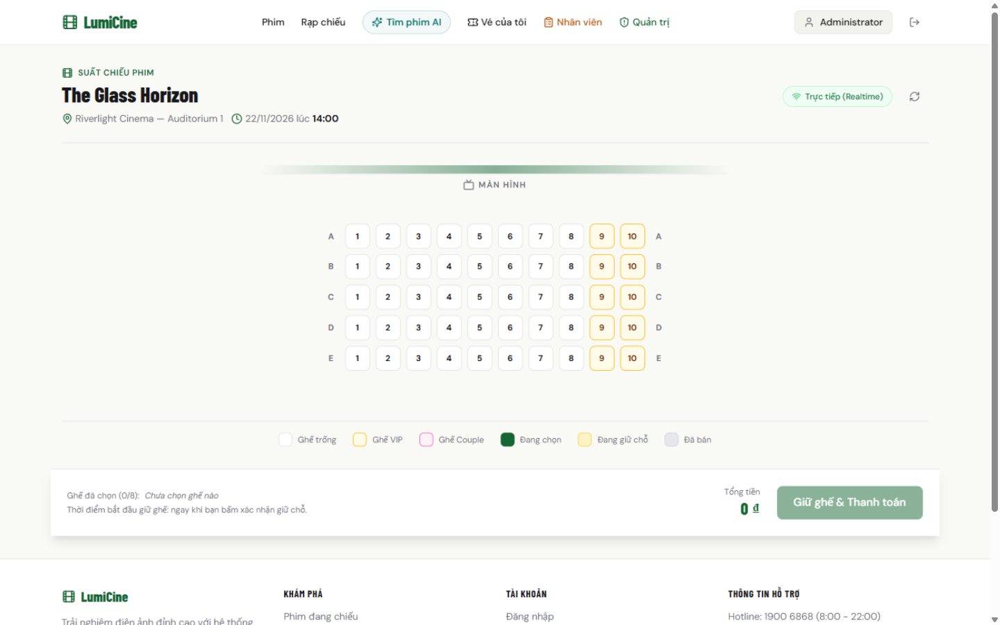
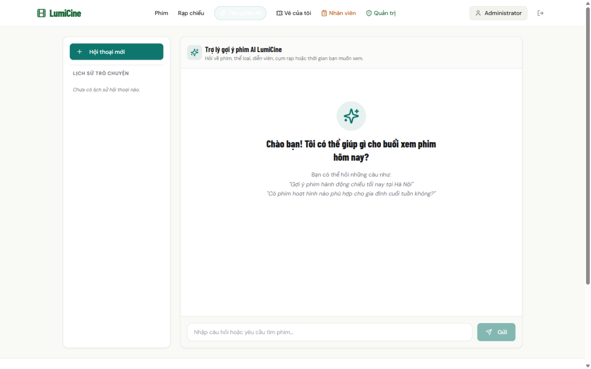
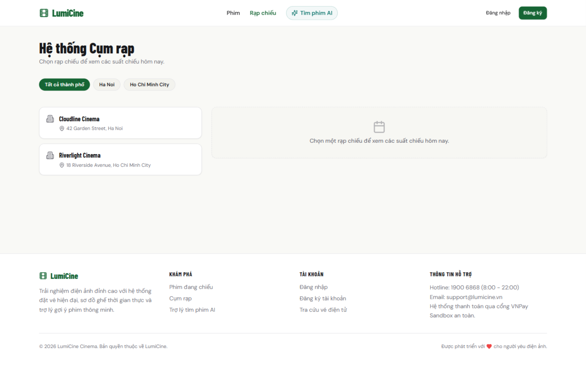
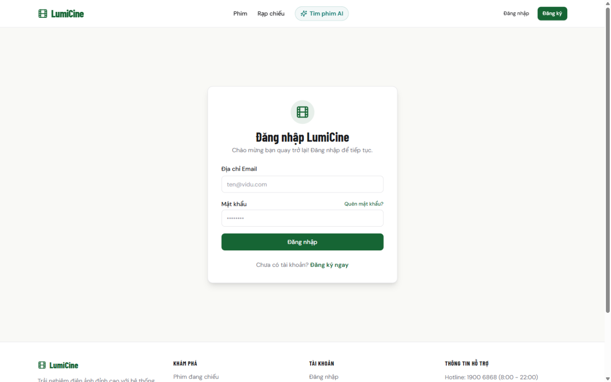
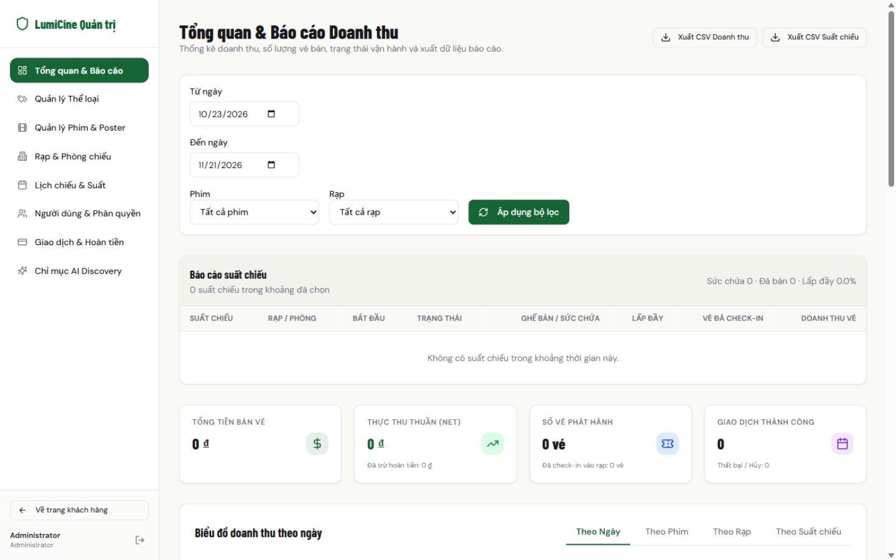
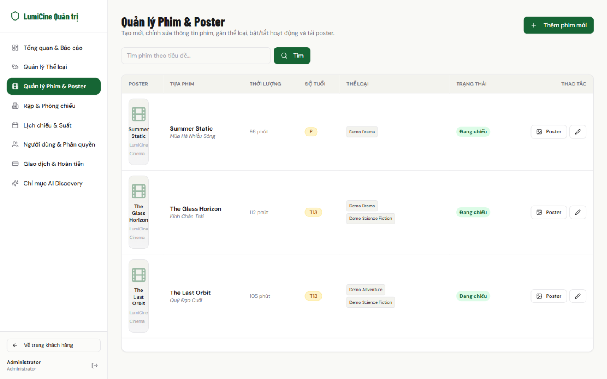
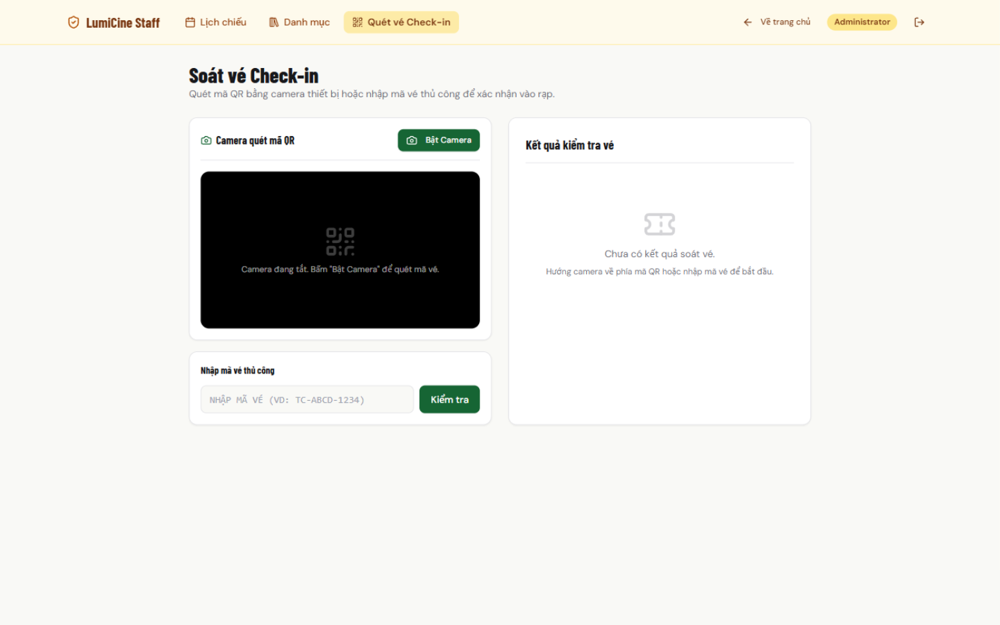

# LumiCine — Online Movie Ticket Booking System

LumiCine is a fullstack cinema booking application: realtime seat selection over SignalR, payment via the VNPay (Sandbox) gateway, e-tickets with QR check-in, and an AI-powered assistant that recommends movies and showtimes.

## Screenshots

| Home | Movie Details & Showtimes |
| --- | --- |
|  |  |

| Realtime Seat Selection | AI Discovery Assistant |
| --- | --- |
|  |  |

| Cinemas | Sign in |
| --- | --- |
|  |  |

| Admin — Dashboard & Reports | Admin — Movies & Posters |
| --- | --- |
|  |  |

| Staff — Ticket Check-in | |
| --- | --- |
|  | |

## Features

### Customer
- **Movie catalog**: search, filter by genre, and a detail page with showtimes per date and cinema
- **Realtime seat selection**: live seat map over SignalR (available, VIP, couple, held, sold)
- **AI Discovery assistant**: conversational recommendations for movies, genres, cinemas and showtimes
- **VNPay payment** (Sandbox) with automatic release of expired seat holds
- **E-tickets**: lookup and QR codes used for check-in at the cinema

### Admin
- Dashboard and revenue reports (by day, movie, cinema, showtime) with CSV export
- Manage movies, posters, genres, cinemas, auditoriums and seat layouts
- Manage schedules and showtimes
- User management and role assignment
- Payment and refund tracking
- AI Discovery index management

### Staff
- View schedules and the movie catalog
- Check in tickets by scanning the QR code (camera or manual code entry)

## Technology Stack

| Component | Technologies |
| --- | --- |
| Backend | .NET 10 (ASP.NET Core Web API), Clean Architecture (Domain / Application / Infrastructure / API) |
| Database | PostgreSQL 16+ with EF Core (Npgsql) migrations |
| Realtime | SignalR (`/hubs/showtimes`) |
| Security | ASP.NET Identity (JWT), CSRF protection, rate limiting |
| Integrations | VNPay Payment Sandbox, SMTP email, AI Discovery |
| Frontend | React 18 + TypeScript, Vite, Tailwind CSS, Radix UI, TanStack Query, React Hook Form + Zod |
| Testing | xUnit (unit + integration), Vitest, Playwright (E2E acceptance) |

## Project Structure

```
LumiCine/
├── backend/
│   ├── LumiCine.API/              # Web API, SignalR hub, background workers (booking expiration, ticket email, embeddings)
│   ├── LumiCine.Application/      # Use cases, DTOs, role names
│   ├── LumiCine.Domain/           # Entities and business rules
│   └── LumiCine.Infrastructure/   # EF Core, Identity, external services (VNPay, email, AI)
├── frontend/
│   └── lumicine-web/              # React SPA (customer, staff and admin areas)
├── tests/
│   ├── LumiCine.UnitTests/
│   └── LumiCine.IntegrationTests/
└── docs/                          # Design documents and screenshots
```

## Getting Started

### Prerequisites

- [.NET SDK 10](https://dotnet.microsoft.com/download) (see `global.json`)
- PostgreSQL 16+ running locally
- Node.js 20+

### 1. Configure the database

Create the database and user (choose your own password):

```sql
CREATE ROLE lumicine LOGIN PASSWORD '<your-password>';
CREATE DATABASE lumicine_dev OWNER lumicine;
```

Store the connection string in the **user secrets** of `backend/LumiCine.API`:

```bash
cd backend/LumiCine.API
dotnet user-secrets set "ConnectionStrings:LumiCine" "Host=127.0.0.1;Port=5432;Database=lumicine_dev;Username=lumicine;Password=<your-password>"
```

### 2. Create the schema and seed data

```bash
# Apply EF Core migrations
dotnet ef database update \
  --project backend/LumiCine.Infrastructure \
  --startup-project backend/LumiCine.API

# Create the first admin account (configured in user secrets)
dotnet user-secrets set "BootstrapAdmin:Email" "admin@example.com"
dotnet user-secrets set "BootstrapAdmin:Password" "<admin-password>"
dotnet run --project backend/LumiCine.API -- --seed-admin

# Demo data: movies, cinemas and showtimes
dotnet run --project backend/LumiCine.API -- --seed-demo
```

### 3. Run the backend and frontend

```bash
# Backend — https://localhost:7005 (the "http" profile serves http://localhost:5005)
dotnet run --project backend/LumiCine.API

# Frontend — https://localhost:5173 (proxies /api and /hubs to the backend on 7005)
cd frontend/lumicine-web
npm install
npm run dev
```

Open **https://localhost:5173** and sign in with the seeded admin account.

> Note: the Vite dev server uses a self-signed certificate (`@vitejs/plugin-basic-ssl`); accept the browser warning to continue.

## Testing

```bash
# Backend unit and integration tests
dotnet test

# Frontend unit tests (Vitest)
cd frontend/lumicine-web && npm test

# E2E acceptance (Playwright) — creates a dedicated e2e database on 127.0.0.1:55439
cd frontend/lumicine-web && npm run e2e
```

## Additional Documentation

- [docs/database-design.md](docs/database-design.md) — database design

---

Copyright 2026 LumiCine Cinema.
