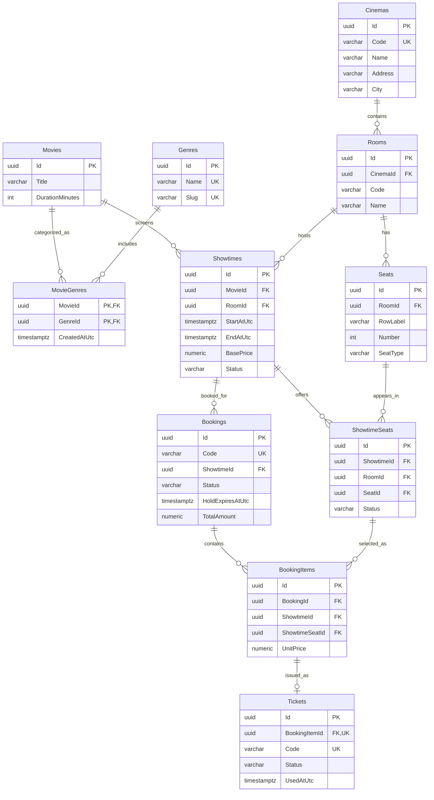

# Thiết kế cơ sở dữ liệu Phase 1

PostgreSQL 18, EF Core 10 và Npgsql. Tên bảng/cột bên dưới dùng PascalCase để khớp tên miền .NET. Khóa chính là `uuid` (C# `Guid`); thời điểm là `timestamptz` và phải được ứng dụng ghi dưới dạng UTC. Tiền VND dùng `numeric(18,2)` (C# `decimal`) và không âm. Ràng buộc xóa mặc định là `RESTRICT` để không làm mất dữ liệu lịch sử; riêng bảng nối `MovieGenres` có thể xóa cascade theo phim/thể loại.

## ERD

## Bảng và cột

`NOT NULL` được áp dụng cho mọi cột trừ khi ghi rõ `NULL`. Các cột `Id` được tạo UUID ở ứng dụng; thời điểm tạo/cập nhật dùng UTC.

### Movies

| Cột | Kiểu | Ràng buộc / ý nghĩa |
|---|---|---|
| `Id` | `uuid` | PK |
| `Title` | `varchar(200)` | Không rỗng |
| `OriginalTitle` | `varchar(200)` | NULL |
| `Synopsis` | `text` | NULL |
| `DurationMinutes` | `integer` | `> 0` |
| `ReleaseDate` | `date` | NULL |
| `AgeRating` | `varchar(20)` | NULL |
| `PosterUrl` | `varchar(2048)` | NULL |
| `IsActive` | `boolean` | Mặc định `true` |
| `CreatedAtUtc` | `timestamptz` | Bắt buộc UTC |
| `UpdatedAtUtc` | `timestamptz` | NULL đến khi cập nhật |

### Genres

| Cột | Kiểu | Ràng buộc / ý nghĩa |
|---|---|---|
| `Id` | `uuid` | PK |
| `Name` | `varchar(100)` | Không rỗng, unique |
| `Slug` | `varchar(120)` | Không rỗng, unique |
| `CreatedAtUtc` | `timestamptz` | Bắt buộc UTC |

### MovieGenres

| Cột | Kiểu | Ràng buộc / ý nghĩa |
|---|---|---|
| `MovieId` | `uuid` | PK ghép, FK → `Movies.Id`, xóa cascade |
| `GenreId` | `uuid` | PK ghép, FK → `Genres.Id`, xóa cascade |
| `CreatedAtUtc` | `timestamptz` | Bắt buộc UTC |

### Cinemas

| Cột | Kiểu | Ràng buộc / ý nghĩa |
|---|---|---|
| `Id` | `uuid` | PK |
| `Code` | `varchar(30)` | Không rỗng, unique |
| `Name` | `varchar(160)` | Không rỗng |
| `Address` | `varchar(300)` | Không rỗng |
| `City` | `varchar(100)` | Không rỗng |
| `IsActive` | `boolean` | Mặc định `true` |
| `CreatedAtUtc` | `timestamptz` | Bắt buộc UTC |
| `UpdatedAtUtc` | `timestamptz` | NULL đến khi cập nhật |

### Rooms

| Cột | Kiểu | Ràng buộc / ý nghĩa |
|---|---|---|
| `Id` | `uuid` | PK |
| `CinemaId` | `uuid` | FK → `Cinemas.Id`, restrict |
| `Code` | `varchar(30)` | Không rỗng; unique cùng `CinemaId` |
| `Name` | `varchar(100)` | Không rỗng |
| `IsActive` | `boolean` | Mặc định `true` |
| `CreatedAtUtc` | `timestamptz` | Bắt buộc UTC |
| `UpdatedAtUtc` | `timestamptz` | NULL đến khi cập nhật |

### Seats

| Cột | Kiểu | Ràng buộc / ý nghĩa |
|---|---|---|
| `Id` | `uuid` | PK |
| `RoomId` | `uuid` | FK → `Rooms.Id`, restrict |
| `RowLabel` | `varchar(10)` | Không rỗng |
| `Number` | `integer` | `> 0` |
| `SeatType` | `varchar(30)` | Ví dụ `Standard`, `VIP`, `Couple`; giá trị giới hạn bởi ứng dụng ở Phase 1 |
| `IsActive` | `boolean` | Mặc định `true` |
| `CreatedAtUtc` | `timestamptz` | Bắt buộc UTC |

Unique `(RoomId, RowLabel, Number)` và unique `(Id, RoomId)`.

### Showtimes

| Cột | Kiểu | Ràng buộc / ý nghĩa |
|---|---|---|
| `Id` | `uuid` | PK |
| `MovieId` | `uuid` | FK → `Movies.Id`, restrict |
| `RoomId` | `uuid` | FK → `Rooms.Id`, restrict |
| `StartAtUtc` | `timestamptz` | Bắt buộc UTC |
| `EndAtUtc` | `timestamptz` | Bắt buộc UTC, `EndAtUtc > StartAtUtc` |
| `BasePrice` | `numeric(18,2)` | `>= 0`, VND |
| `Status` | `varchar(20)` | `Scheduled`, `Cancelled` hoặc `Completed`; CHECK |
| `CreatedAtUtc` | `timestamptz` | Bắt buộc UTC |
| `UpdatedAtUtc` | `timestamptz` | NULL đến khi cập nhật |

Unique `(Id, RoomId)` hỗ trợ khóa ngoại ghép của `ShowtimeSeats`.

### ShowtimeSeats

| Cột | Kiểu | Ràng buộc / ý nghĩa |
|---|---|---|
| `Id` | `uuid` | PK |
| `ShowtimeId` | `uuid` | Thành phần FK ghép → `Showtimes(Id, RoomId)` |
| `RoomId` | `uuid` | Room dùng để bảo đảm ghép đúng suất chiếu và ghế |
| `SeatId` | `uuid` | Thành phần FK ghép → `Seats(Id, RoomId)` |
| `Status` | `varchar(20)` | `Available`, `Held` hoặc `Sold`; CHECK |
| `Price` | `numeric(18,2)` | `>= 0`, VND tại suất chiếu |
| `CreatedAtUtc` | `timestamptz` | Bắt buộc UTC |

Unique `(ShowtimeId, SeatId)` ngăn tạo ghế lặp trong cùng suất chiếu. Unique `(Id, ShowtimeId)` phục vụ khóa ngoại ghép từ `BookingItems`. Hai FK ghép `(ShowtimeId, RoomId)` → `Showtimes(Id, RoomId)` và `(SeatId, RoomId)` → `Seats(Id, RoomId)` đảm bảo ghế thuộc đúng phòng của suất chiếu. Không có cột `BookingId` ở đây; cơ chế giữ ghế và chủ thể giữ ghế thuộc booking engine của phase sau.

### Bookings

| Cột | Kiểu | Ràng buộc / ý nghĩa |
|---|---|---|
| `Id` | `uuid` | PK |
| `Code` | `varchar(40)` | Không rỗng, unique |
| `ShowtimeId` | `uuid` | FK → `Showtimes.Id`, restrict |
| `Status` | `varchar(20)` | `Pending`, `Confirmed`, `Cancelled` hoặc `Expired`; CHECK |
| `HoldExpiresAtUtc` | `timestamptz` | NULL; thời điểm hết hạn giữ chỗ dự kiến ở phase sau |
| `TotalAmount` | `numeric(18,2)` | `>= 0`, VND snapshot |
| `CreatedAtUtc` | `timestamptz` | Bắt buộc UTC |
| `UpdatedAtUtc` | `timestamptz` | NULL đến khi cập nhật |

Booking gắn với một suất chiếu. Chưa có `UserId` vì người dùng/authentication ở Phase 2. FK đến suất chiếu dùng restrict để bảo toàn lịch sử. Unique `(Id, ShowtimeId)` hỗ trợ khóa ngoại ghép từ `BookingItems`.

### BookingItems

| Cột | Kiểu | Ràng buộc / ý nghĩa |
|---|---|---|
| `Id` | `uuid` | PK |
| `BookingId` | `uuid` | Thành phần FK ghép → `Bookings(Id, ShowtimeId)` |
| `ShowtimeId` | `uuid` | Suất chiếu được lưu tường minh để kiểm tra FK ghép |
| `ShowtimeSeatId` | `uuid` | Thành phần FK ghép → `ShowtimeSeats(Id, ShowtimeId)` |
| `UnitPrice` | `numeric(18,2)` | `>= 0`, VND snapshot lúc đặt |
| `CreatedAtUtc` | `timestamptz` | Bắt buộc UTC |

Unique `(BookingId, ShowtimeSeatId)` cấm cùng một booking thêm lặp ghế. Composite FK `(BookingId, ShowtimeId)` → `Bookings(Id, ShowtimeId)` và `(ShowtimeSeatId, ShowtimeId)` → `ShowtimeSeats(Id, ShowtimeId)` đảm bảo item cùng suất chiếu với cả booking và ghế. Không đặt unique toàn cục trên `ShowtimeSeatId`: booking đã hết hạn/hủy có thể lưu lịch sử và ghế có thể được đặt lại.

### Tickets

| Cột | Kiểu | Ràng buộc / ý nghĩa |
|---|---|---|
| `Id` | `uuid` | PK |
| `BookingItemId` | `uuid` | FK → `BookingItems.Id`, unique, restrict |
| `Code` | `varchar(60)` | Không rỗng, unique |
| `Status` | `varchar(20)` | `Issued`, `Used` hoặc `Voided`; CHECK |
| `IssuedAtUtc` | `timestamptz` | Bắt buộc UTC |
| `UsedAtUtc` | `timestamptz` | NULL cho đến khi sử dụng |
| `CreatedAtUtc` | `timestamptz` | Bắt buộc UTC |

Không unique `ShowtimeSeatId` ở vé: seat có thể xuất hiện trong các booking lịch sử khác nhau theo thời gian. FK restrict giữ nguyên vé và lịch sử booking.

## Ràng buộc và quy ước chung

- Khóa ngoại nghiệp vụ dùng `ON DELETE RESTRICT`; không hard-delete booking, booking item, ticket, suất chiếu hoặc ghế đã có lịch sử. `MovieGenres` được cascade vì chỉ là quan hệ phân loại.
- CHECK: `Movies.DurationMinutes > 0`; `Seats.Number > 0`; `Showtimes.EndAtUtc > StartAtUtc`; tất cả giá/tổng tiền `>= 0`.
- Các status lưu chuỗi có CHECK đúng theo tập giá trị đã nêu trong bảng tương ứng.
- Các unique chính: `Genres.Name`, `Genres.Slug`, `Cinemas.Code`, `(Rooms.CinemaId, Rooms.Code)`, `(Seats.RoomId, Seats.RowLabel, Seats.Number)`, `(ShowtimeSeats.ShowtimeId, ShowtimeSeats.SeatId)`, `Bookings.Code`, `(Bookings.Id, Bookings.ShowtimeId)`, `(BookingItems.BookingId, BookingItems.ShowtimeSeatId)`, `Tickets.BookingItemId`, `Tickets.Code`.
- Chưa triển khai khóa đồng thời/giữ ghế, thanh toán hoặc chuyển trạng thái tự động; các trạng thái mô tả dữ liệu cần hỗ trợ, không hàm ý đã có quy trình nghiệp vụ.
